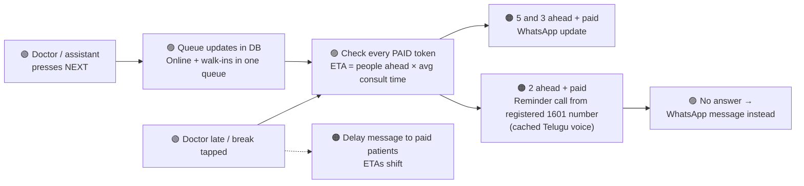

# OpgO Blueprint — WhatsApp-first OPD token booking

> **Book on WhatsApp, pay ₹30, get called before your turn.**

Visual whiteboard version: https://claude.ai/artifact/AVpvsNNAySQ1DEuANtZnpo

**Colour key used in diagrams:** 🔵 Patient sees · 🟢 Hospital staff do · 🟣 OpgO automatic · 🟠 Money / paid only

---

## 1. Patient journey (what the customer sees)

```mermaid
flowchart LR
    A["1. Find OpgO<br/>QR at hospital, posters,<br/>one easy OpgO number"] --> B["2. Contact OpgO<br/>WhatsApp / missed call / phone<br/>First time: consent + DELETE option"]
    B --> C["3. We recognise you<br/>'Ela unnaru?' + last hospital<br/>Token for whom? (family)"]
    C --> D["4. Choose<br/>Town → hospital → doctor → session<br/>Only open sessions, until daily limit"]
    D --> E["5. Token issued<br/>Token no., people ahead, ETA<br/>Sent as 'OpgO + hospital name'"]
    E --> F["6. Pay ₹30 to unlock<br/>WhatsApp pay link (also after phone booking)<br/>Unpaid = token only"]
    F --> G["7. Live updates (paid only)<br/>5 ahead, 3 ahead, doctor late"]
    G --> H["8. Reminder call (paid only)<br/>'2 tokens left, come to Room 4'"]
    H --> I["9. Arrive & consult<br/>Missed turn → re-join or cancel<br/>2 unpaid no-shows → pay first"]
    I --> J["10. Counter<br/>Check token, send patient in"]
    J --> K["11. After visit<br/>Thank-you; rebook next time in one tap"]

    classDef patient fill:#E6F1FB,stroke:#185FA5,color:#0C447C
    classDef staff fill:#EAF3DE,stroke:#3B6D11,color:#27500A
    classDef money fill:#FAECE7,stroke:#993C1D,color:#712B13
    class A,B,C,D,E,I,K patient
    class J staff
    class F,G,H money
```



| Tier | Gets |
|---|---|
| **Unpaid** | Token only (no updates, no call) |
| **Paid ₹30** | Token + WhatsApp live updates + AI reminder call |

---

## 2. Live tracking — how "your turn is near" works



**Reminder call script (one-way, no AI conversation):**
> Namaskaram {name} garu, OpgO nundi call chestunnam. Mee token number {token}. Inka {n} tokens tarvata mee turn. {doctor}, Room {room} daggara undandi. OpgO ni enchukunnanduku dhanyavadalu.

Fixed parts + numbers 1–300 + doctor/room names are pre-generated once (Sarvam Bulbul) and stitched → near-zero TTS cost per call.

---

## 3. Money

- **₹30 per booking unlocks everything**; unpaid = token only
- Phone bookers receive a WhatsApp payment link after the call
- Automatic refund if hospital cancels / doctor absent
- Cost per paid booking ≈ ₹1–2 (call minutes, WhatsApp utility messages, gateway)
- You keep ≈ ₹19–25 after GST
- Fixed ≈ ₹500–3,000/month → break-even ≈ 30–150 paid bookings/month
- MoU with each hospital; GST invoices (confirm with a CA)

**Payments**
| Phase | How | Confirmation |
|---|---|---|
| Pilot | Direct UPI to PhonePe Business UPI ID | Reception / admin taps **Mark paid** |
| Launch | PhonePe PG / Cashfree in **UPI intent** mode (patient still pays in PhonePe/GPay) | Webhook → features unlock automatically |

*All costs are estimates — verify current rate cards before launch.*

---

## 4. Apps & screens (patients need NO app)

| Screen | Who | Does |
|---|---|---|
| WhatsApp + phone | 🔵 Patient | Book, pay, get updates/calls. Elderly: missed call / SMS link |
| Reception web app | 🟢 Reception | Send to room, walk-ins, arrived/absent, paid/unpaid, print slip (see §7) |
| Doctor / assistant screen | 🟢 Doctor side | One big NEXT button; pause, break, doctor late |
| Hospital admin | 🟢 Hospital | Doctors, OPD sessions, daily token limit, booking open time, fees, avg consult time, daily report |
| OpgO admin | 🟣 You | Onboard hospitals, pricing, settlements, refunds, failed calls, analytics |
| Waiting-hall TV (optional) | 🟢 Hospital | "Now serving: Token 21" per doctor |

---

## 5. Tech behind it

| Part | What it does |
|---|---|
| One OpgO number | Virtual 10-digit number (Exotel/Plivo), same number registered on WhatsApp |
| WhatsApp Cloud API | Booking chat, approved templates, opt-in, payment requests, updates |
| Payments | Pilot: direct UPI + manual "Mark paid". Later: PhonePe PG / Cashfree UPI intent → auto unlock |
| Firebase | Firestore DB, Cloud Functions, staff login, web app hosting |
| Reminder calls | Registered 1601 number (Plivo/Exotel) plays cached Sarvam Telugu audio |
| Data stored | Hospitals, doctors, sessions, tokens, patients, family, consent, payments, call logs |
| Later | Missed-call booking; AI voice booking (Sarvam STT + LLM + TTS) |

---

## 6. Also consider (don't skip these)

| Area | What to handle | Where in blueprint |
|---|---|---|
| Privacy & consent | Consent at first booking; DELETE option; store no diagnosis; don't say department aloud on calls | Step 2 |
| Shared family phones | Ask "token for whom?"; save family members under one number | Step 3 |
| Doctor late / break / emergency | One tap sends delay message to everyone waiting, shifts ETAs | §2, §7 |
| Walk-ins vs online | One queue, same token sequence; optionally reserve slots | §2, §7 |
| OPD sessions | Morning/evening sessions, daily token limit, booking opening time | Step 4, Hospital admin |
| Missed turn & no-shows | Re-join after next patient or cancel; 2 unpaid no-shows → must pay first | Step 9, §7 |
| Refunds | Automatic refund if hospital cancels or doctor absent | §3, OpgO admin |
| No WhatsApp / basic phone | Missed-call or phone booking + SMS updates and SMS pay link | Step 2, §4 |
| Internet down at hospital | Paper tokens continue; app syncs when back online | §7 |
| Telecom rules | Reminder calls need registered service number (1601 series / DLT); no ads in calls | §2, §5 |
| WhatsApp rules | Approved templates, opt-in, call permission; limits grow after verification | §5 |
| Trust | "OpgO + hospital name"; verified WhatsApp profile; confirmation first | Step 5 |
| Hospital agreement (MoU) | Fee shown to patients, monthly settlement terms, exclusivity in town | §3 |
| Money & tax | GST registration, invoices, gateway settlement; confirm with a CA | §3 |
| Protect the idea | Trademark OpgO + logo; check employment contract; private repo; NDAs | Before launch |
| Measure | Bookings/day, paid %, no-show %, average wait, cost per booking | Hospital + OpgO admin |

---

## 7. Reception app plan (easy, max 2 taps, always live)

**Screen sketch**
```
┌──────────────────────────────────────────────────────────────────┐
│ OpgO Reception · Sri Sai Hospital · ● Live (synced) · తెలుగు/EN  │
├──────────────────────────────────────────────────────────────────┤
│ [Dr. Reddy · Ortho · 12 waiting] [Dr. Lakshmi · Gen · 8] [+ Dr]  │
├────────────────────────────────┬─────────────────────────────────┤
│ NOW IN ROOM: Token 21          │ NEXT: Token 22                  │
│ Ramesh, 54 · in room 6 min     │ Lakshmi · Paid · Arrived        │
├────────────────────────────────┴─────────────────────────────────┤
│                 [   SEND NEXT TO ROOM  ▶   ]                     │
├──────────────────────────────────────────────────────────────────┤
│ [+ Walk-in] [Skip / absent] [Doctor break / late] [Search]       │
├──────┬─────────────────┬──────────────────┬────────┬────────────┤
│ 22   │ Lakshmi         │ Arrived          │ Paid   │ Send to room│
│ 23   │ Venkat          │ Not arrived      │ Unpaid │ Mark arrived│
│ 24   │ Salma (walk-in) │ Arrived          │ Unpaid │ Mark paid   │
│ 25   │ Ravi            │ Absent (skipped) │ Paid   │ Re-join     │
└──────┴─────────────────┴──────────────────┴────────┴────────────┘
```

**Design rules**
- One screen, big buttons, Telugu / English
- Max 2 taps per action; no typing except a walk-in's name
- Runs in the browser on any cheap Android phone/tablet (PWA, no install)
- Status colours: green in room, yellow arrived, grey not arrived, red absent
- Undo for 10 seconds after every tap

**What reception does (1–2 taps each)**
- Send next to room (doctor can also press Next)
- Mark arrived when the patient reaches the counter
- Add walk-in → next token shown / slip printed
- Skip absent → missed list; Re-join later
- Emergency or elderly priority → move to top
- Doctor break or late → delay message to paid patients
- Mark paid (pilot: after checking PhonePe Business)
- Search by token number or phone

**Always up to date**
- Live sync: every desk, doctor screen and TV updates in 1–2 seconds
- Live/Offline badge; offline taps sync later; full outage → paper tokens, enter later
- One queue per doctor; hospital decides who presses Next (reception or doctor)
- End of day: tokens, walk-ins, paid, no-shows, average wait
- 15-minute training + Telugu cheat-sheet sticker at the desk

---

## 8. Milestones

| # | Milestone | Outcome |
|---|---|---|
| M0 | Validate & protect | 2 pilot hospitals signed (MoU); trademark filed; contract checked |
| M1 | Foundation | Firebase project, data model, WhatsApp Cloud API test number |
| M2 | WhatsApp booking v1 | Consent, recognition, family, choose, token issued |
| M3 | Reception & doctor app | Send-to-room, walk-ins, arrived/absent, offline, undo |
| M4 | Live tracking & paid updates | Queue triggers, ETA, delay broadcast, WhatsApp updates |
| M5 | Payments | Pilot UPI + Mark paid; gateway webhook; refunds |
| M6 | Reminder calls | 1601 number, cached Sarvam audio, no-answer fallback |
| M7 | Pilot launch | One hospital live; training; daily metrics |
| M8 | Scale | Missed-call booking, AI voice booking, more hospitals, settlements |
